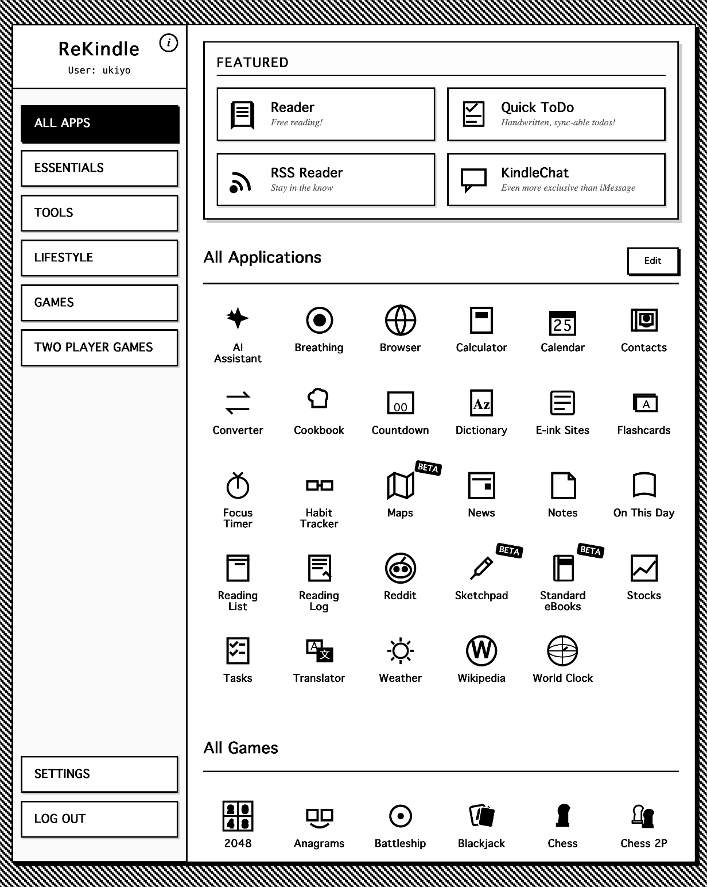
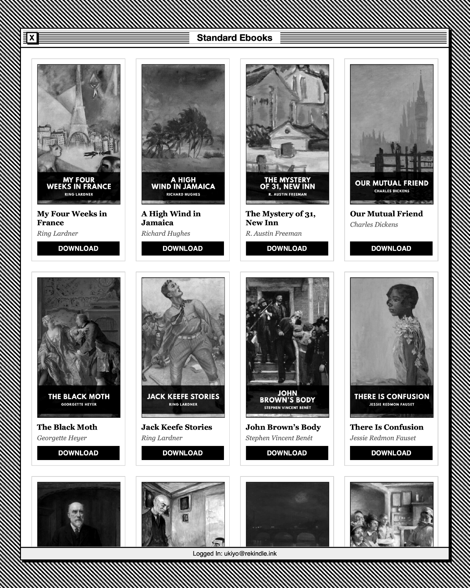
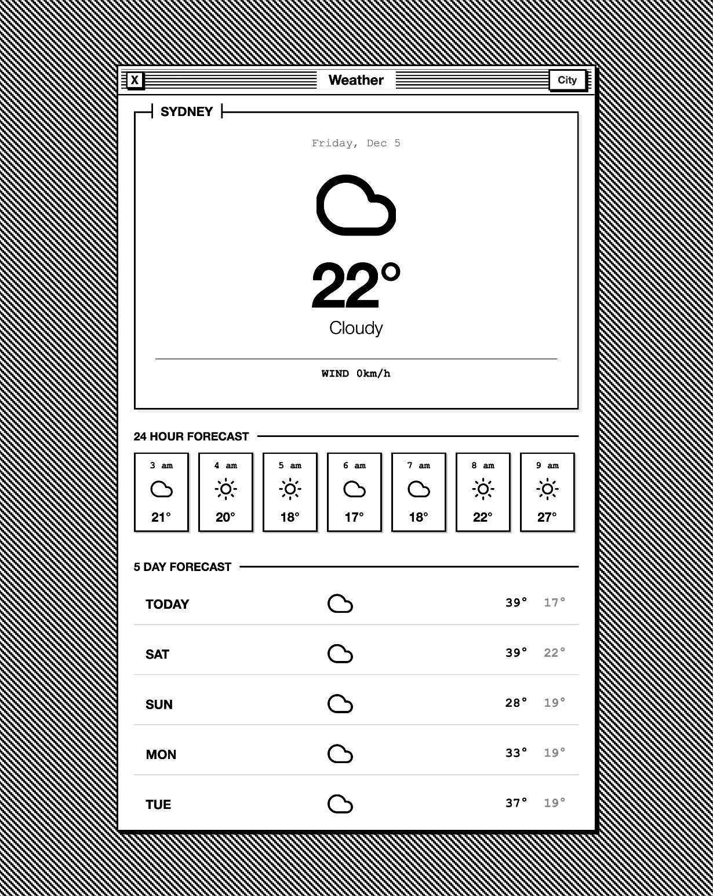
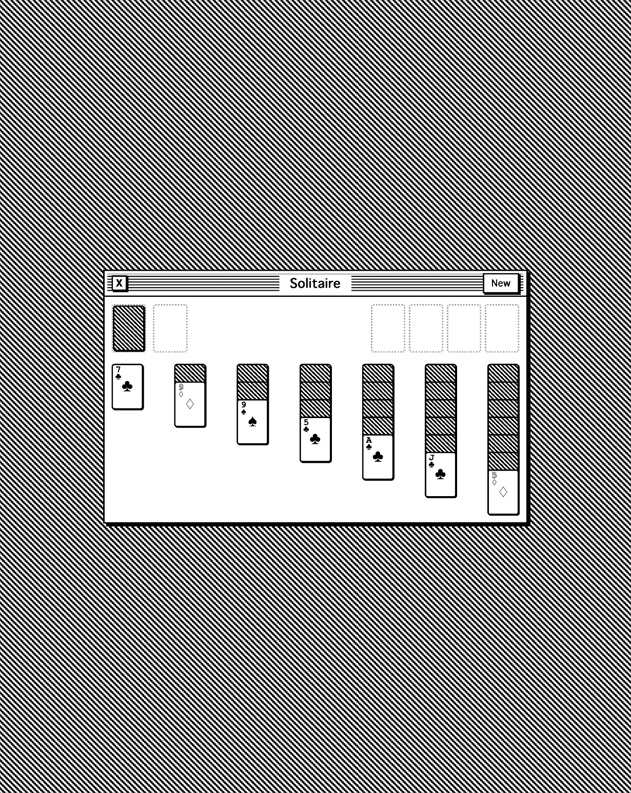
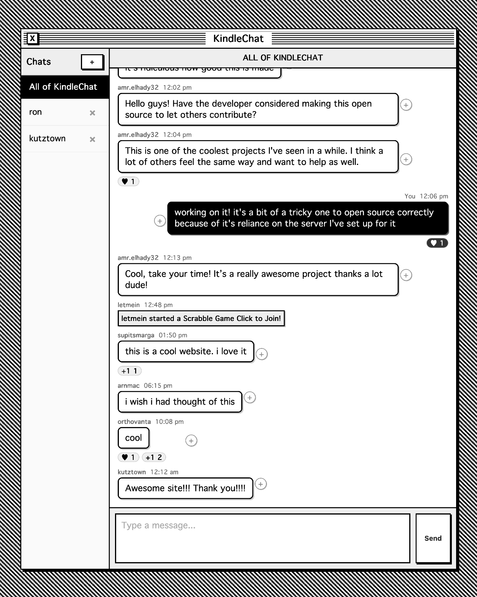
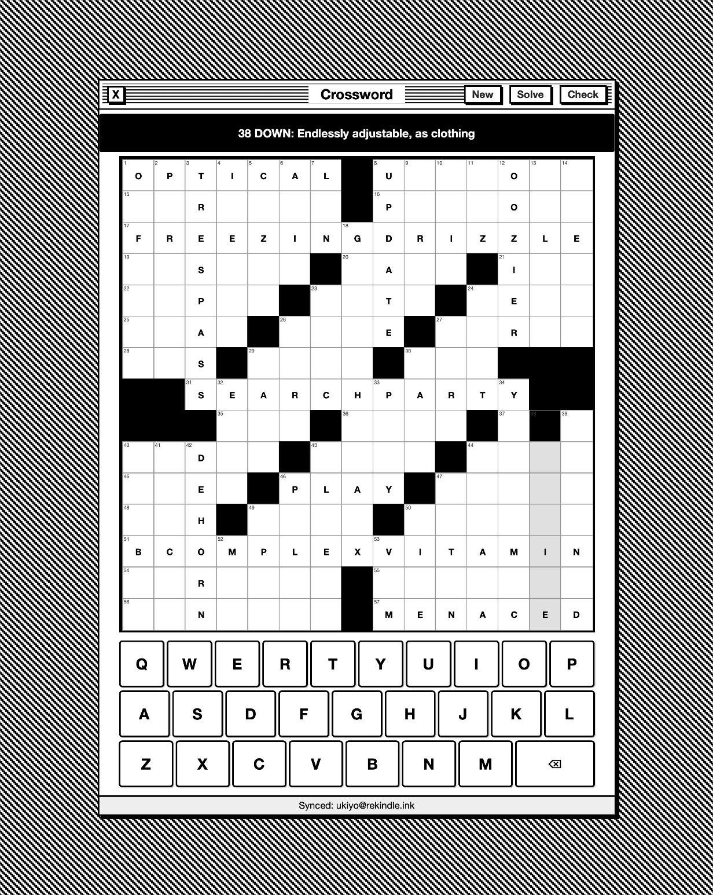
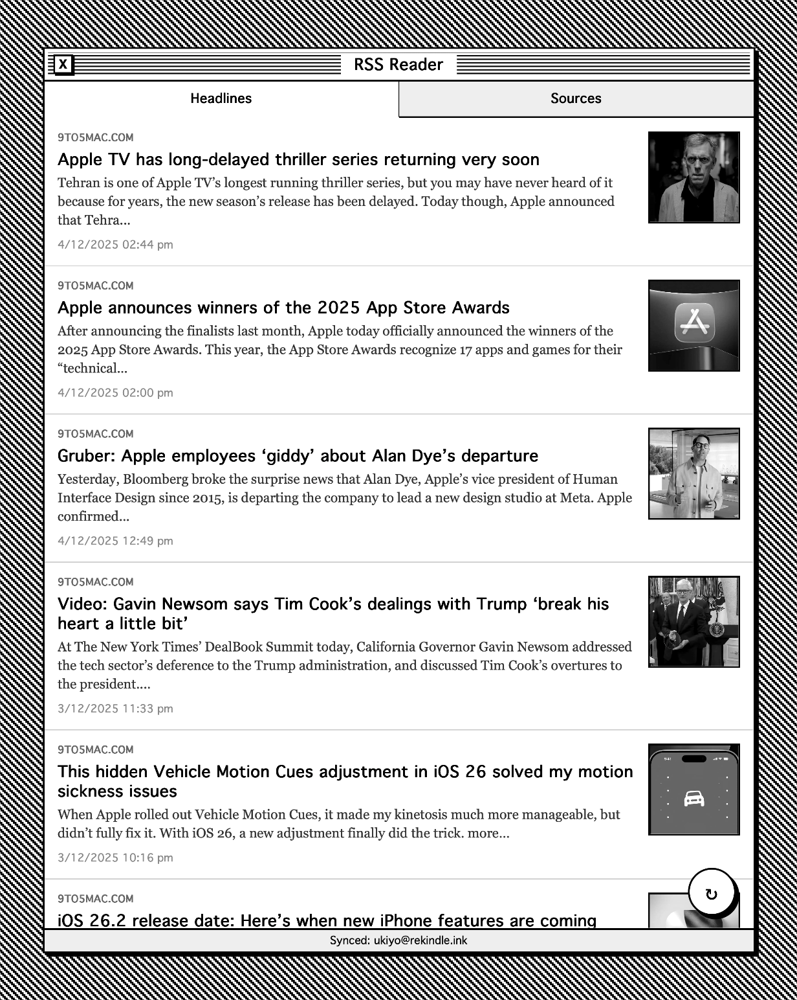
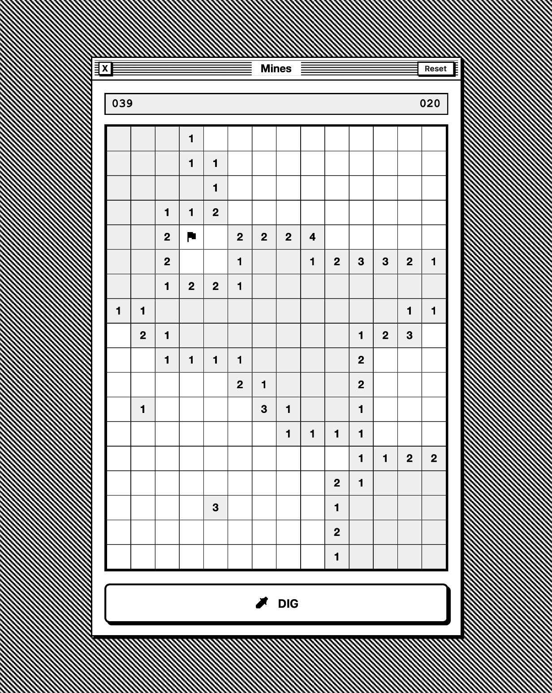
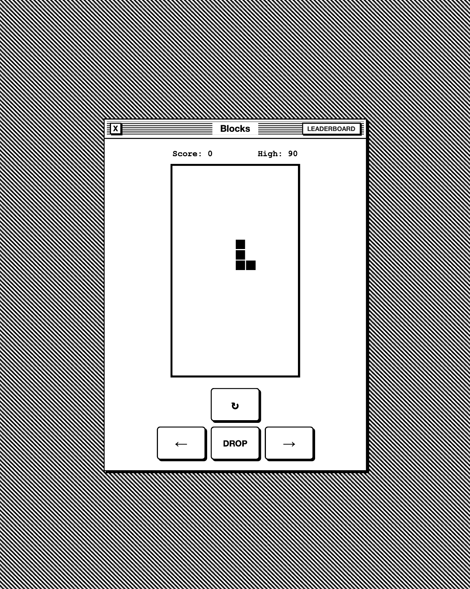

# ReKindle

**Your E-Ink Device, Upgraded.**

ReKindle is a web-based dashboard for E-ink devices (Kindle, Kobo, Boox, etc.). It transforms your e-reader into a powerful productivity tool, gaming device, news hub & more.

## Setup & Installation

ReKindle is a Progressive Web App (PWA). No "installation" or jailbreak is required.

1.  Open the web browser on your E-ink device.
2.  Navigate to `rekindle.ink`.
3.  **Recommended:** Bookmark the page or add it to your device's home screen if supported.

### Jailbroken Kindle: fullscreen (highly experimental)

**Highly experimental:** this add-on is a community experiment, not a supported ReKindle feature. It changes how the Kindle starts its browser, it has very little real-device testing, and a failed launch can leave the device stuck until you reboot it. Do not install it on a Kindle you depend on; nothing in ReKindle requires it, and a bookmark works on every supported device.

Firmware 5.16.4+ can run ReKindle with **no Kindle interface and no browser chrome**. The optional scriptlet mounts `chromium.sqsh`, stops the Kindle GUI, and launches Chromium as the `framework` user with Amazon’s own flags. ReKindle keeps its normal framed layout; the Kindle UI and browser chrome are removed and restored on exit. It changes nothing on the root filesystem.

*   Step-by-step guide, including jailbreaking: [ReKindle for Kindle](kindle.html)
*   Install over USB: download `downloads/ReKindle-Fullscreen.zip` and copy `documents/` to the Kindle. No computer? Install kterm with `;kpm install kterm`, then run `kpm add-repo https://rekindle.ink/downloads/kpm/repo.json`, `kpm update` and `kpm install rekindle` inside kterm. Do not run `;kpm add-repo` from the search bar: Amazon rejects `.` and `:` in `;` commands.
*   The stock browser rejects direct `.sh`/`.txt` downloads as **Invalid file type**; KPM or USB is required.
*   Source and recovery scripts: [`kindle/`](kindle/)

## Gallery

<p align="center">
  
  
  
</p>

<p align="center">
  
  
  
</p>

<p align="center">
  
  
  
</p>

<p align="center">
  
  
</p>

## Features

ReKindle operates in two modes: **Guest Mode** (all data stored locally on your device) and **Cloud Mode** (create an account to sync data across devices).

### Help & Documentation
*   **Help & FAQ:** An in-app guide to every app, game, account feature and setting, with search, an A-Z index and troubleshooting. Open it from the Help link in the top menu or the About panel.

### Productivity & Organization
*   **Quick ToDo⁺:** A unique task manager that uses **OCR (Handwriting Recognition)** to convert your handwriting into digital, sync-able tasks.
*   **Google Integration:** Read/write sync for **Google Tasks** and **Google Calendar**, plus a read-only **Google Contacts** address-book import.
*   **Mail⁺:** A fully functional email client for your E-ink device.
*   **Universal Import:** Read-only **CalDAV / iCalendar** and **CardDAV / vCard** feeds for non-Google users.
*   **Note Pad:** A clean, distraction-free writing environment.
*   **Habit Tracker:** Keep your streaks alive with a visual weekly tracker.
*   **Focus Timer:** A Pomodoro-style timer to boost productivity.
*   **Decider:** A random decision engine for when you just can't choose.
*   **Mindmap:** Visually organize your ideas and concepts.
*   **Teleprompter:** Display notes line-by-line for speeches or practice.

### Reading & News
*   **Reader:** A fully functional EPUB reader powered by `epub.js` with library management.
*   **Library Integration:** Built-in search and download for **Project Gutenberg**, **Standard Ebooks**, and **Libby**.
*   **NetLite:** A lightweight, text-only web browser powered by **FrogFind**, optimizing the web for E-ink screens.
*   **RSS Reader:** Follow your favorite feeds in a clean, readable format.
*   **The Daily Kindling:** A daily newspaper aggregating top headlines from world news, tech, science, and more.
*   **Reading Log & List:** Track your daily reading minutes and maintain a "To-Read" wish list with search integration.

### Knowledge & Tools
*   **Oracle AI⁺:** Chat with **Gemini 2.5**, optimized for text-based responses.
*   **Atlas:** Global maps powered by OpenStreetMap.
*   **Babel:** Text translator supporting multiple languages.
*   **Wikipedia:** Search or read random entries from the free encyclopedia.
*   **On This Day:** Discover historical events, births, and deaths for the current date.
*   **Stocks:** Track your portfolio with real-time market data.
*   **Weather:** Current conditions and 5-day forecasts.
*   **Utilities:** Calculator, Unit Converter, Dictionary, World Clock, **AirType⁺** (Phone Typewriter), and Breathing Exercises.

### Games Arcade
**Single Player:**
*   **Word Games:** Wordle, Spelling Bee, Connections, Crossword (NYT Archives), Anagrams, Hangman, Word Search.
*   **Logic & Numbers:** Sudoku, Nerdle (Math Wordle), 2048, Minesweeper, Memory, Jigsaw Puzzles, Tower of Hanoi, Lights Out, Nonograms, Codebreaker.
*   **Classic:** Solitaire, Tetris, Snake, Blackjack, Dino, Pet (Virtual Pet), Block Blast, Texas Hold'em (beta), DOOM (beta).
*   **Mystery:** **Case Files**, a daily/practice whodunit with interview, search, notes and accusation. No timer pressure, no chat and no user-authored cases.

**Multiplayer & Local:**
*   **Words Online:** Play Scrabble-style games asynchronously against other ReKindle users.
*   **Pass-and-Play:** Local 2-player versions of Chess, Checkers, Battleships, Connect 4, Tic-Tac-Toe, and 8 Ball.
*   **Private game codes:** Host a live lobby, tap **Invite a friend**, and share an 8-character code. Private lobbies are hidden from the public list and the code expires after two hours.

### Social & Creative
*   **KindleChat:** An exclusive chat platform for ReKindle users.
*   **Reddit:** A text-optimized Reddit client.
*   **Sketchpad & Pixel Art:** Create simple drawings or 1-bit pixel art canvases, with optional tracing templates.
*   **Flipbook⁺:** Create pixel animations directly on your e-ink device.
*   **Music:** Sheet Music library and Guitar Chords/Tabs search.

*⁺ Features marked with a plus require a **ReKindle+** subscription.*

---

## ⚡ ReKindle+

Support the development of ReKindle and unlock the server-backed features, including Mail, cloud Files and Docs, the hosted AI Assistant, and several integrations. Free accounts keep device-only Files (5 MB), local Docs with .txt export, and one hosted AI message a day.

**Pricing:**
*   **Monthly:** $2/mo
*   **Yearly:** $15/yr
*   **Lifetime:** $30 (One-time payment)

[**Subscribe at rekindle.ink/pay**](https://rekindle.ink/pay)

---

## Privacy

ReKindle is designed with privacy as a priority.

*   **Guest Mode:** By default, ReKindle uses your browser's `localStorage` and creates no server record. Signed-in users can optionally save a one-time **recovery code** and use **Download my data** to export their own records as JSON. Anonymous page-view analytics (Counter.dev) and the third-party requests listed in the [Privacy Policy](https://rekindle.ink/privacy) still occur.
*   **Cloud Sync:** If you choose to log in, app-specific data (notes, tasks, game states) is synced securely via Google Firebase.
*   **Google Data:** Google OAuth tokens are normally stored locally on your device. Quick ToDo is the exception: its Google Tasks token is kept in your private Pro records so the connection follows you between devices. Calendar/Contacts/Tasks data is fetched directly from Google APIs to your browser and is not copied to ReKindle's database; Google Contacts are also cached locally for offline use. See the [Privacy Policy](https://rekindle.ink/privacy).

## License

ReKindle is **source-available**, not open source. It is licensed under the **ReKindle Source License 1.0**.

- **Source** — you may copy, modify, publish, mirror and fork the code publicly for **noncommercial** purposes, with credit to ReKindle and Ukiyo, a link to <https://rekindle.ink>, and a different name and logo for your fork.
- **App** — you may copy, run and modify the app for **personal, noncommercial use only**. You may not deploy, host, publish or distribute the app, a built copy, or a clone — even noncommercially.

Commercial use of any part requires a separate license. Full terms are in [LICENSE](LICENSE); a plain-English summary is in [LICENSE.md](LICENSE.md).

If you publish a modified source, your changes must stay under the same license. The rights granted are perpetual and irrevocable for the version they accompany.

Code published before 26 November 2026 was released under CC BY-NC-SA 4.0, and those copies remain available under that license.

**Commercial use or deploying a clone:** ask first — <hello@rekindle.ink>.

This project does not accept code contributions.

***

## ☁️ Cloud & API Configuration (For Developers)

To enable full functionality (cloud sync, Google integrations, and AI features), you will need to set up your own backend services.

### 1. Firebase Setup (Required for Sync & Auth)
ReKindle uses Google Firebase for user authentication and storing app data.
1.  Go to the [Firebase Console](https://console.firebase.google.com/) and create a project.
2.  Enable **Email/Password** authentication.
3.  Enable **Firestore Database** and set security rules to restrict access to owner-only.

### 2. Google API Setup (Optional for Google Sync)
Enable the **Google Tasks**, **Calendar**, and **People** APIs in the [Google Cloud Console](https://console.cloud.google.com/). Create an OAuth 2.0 Client ID for a Web Application and add your domain to the authorized origins.

### 3. Cloudflare Workers (Backend Proxies)
ReKindle uses specialized Cloudflare Workers to handle sensitive API requests and bypass CORS:
*   **Oracle AI:** Proxies requests to the Google Gemini API.
*   **Quick ToDo OCR:** Handles image processing and OCR for handwritten tasks.
*   **Watchlist (TMDB):** Securely fetches movie and show data.
*   **Chords:** Fetches song tabs and lyrics.
*   **Story (IFDB):** Serves interactive fiction stories.
*   **Stripe:** Manages supporter status and donations.
*   **Translate:** Legacy translation proxy. Current clients translate in the browser through MyMemory (`js/translate-client.js`).

## 🛠️ Building & Deployment

To build the project for different devices, run:
```bash
node build-automation.js
```

This creates three optimized targets in the `_deploy` directory:

1.  **Main (`_deploy/main`):** For modern devices (Chromium-based Kindles on firmware 5.16.4+, desktop, mobile). Minified with ES6+ features.
2.  **Lite (`_deploy/lite`):** Optimized for **pre-Chromium Kindles** (Mesquite / WebKit ~534, firmware below 5.16.4). All app JavaScript is down-levelled to ES5, with local polyfills and the older-device rendering fixes.
3.  **Legacy (`_deploy/legacy`):** Optimized for **Kobo** e-readers (QtWebKit 538.1, ES5 only) and other very old browsers. Features aggressive transpilation, heavy polyfills (AbortController, TextEncoder/Decoder, matchAll, DOM insertion methods), Kobo window/navigation shims, extensionless links (Cloudflare 308 compatibility), and visual warnings for unsupported applications. Open `/probe` on a device to print its capability report.

The build also packages the jailbroken-Kindle add-on into each target's `downloads/` folder. To build only that package:

```bash
npm run build:kindle
```

This writes `downloads/ReKindle-Fullscreen.zip`, the standalone `.sh` files and `SHA256SUMS.txt`. The `/kindle` page links to those files.

---

*Created by [Ukiyo](https://ukiyomusic.com)*
