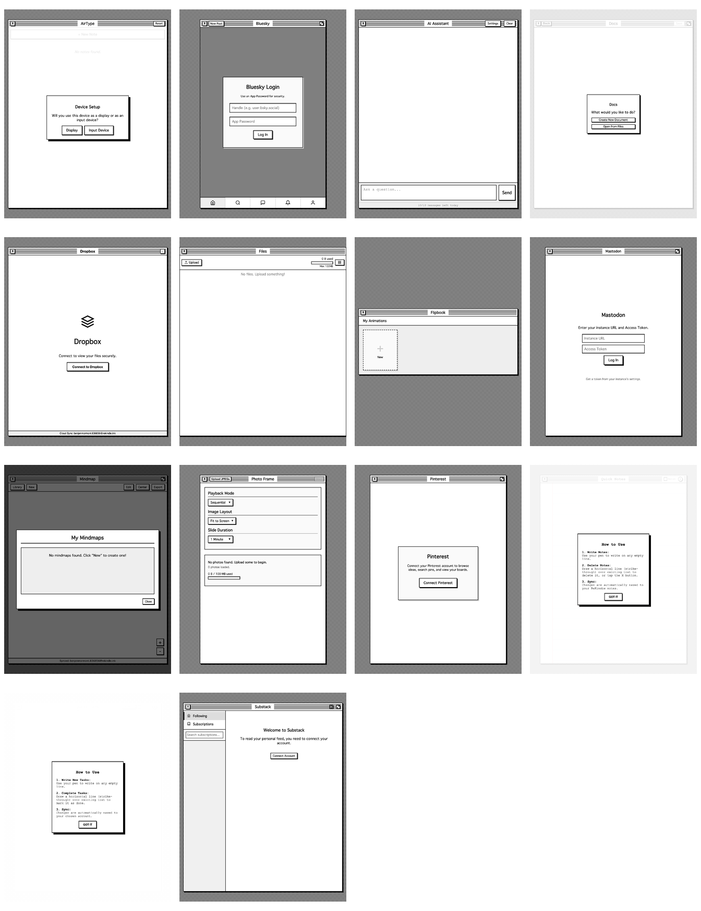
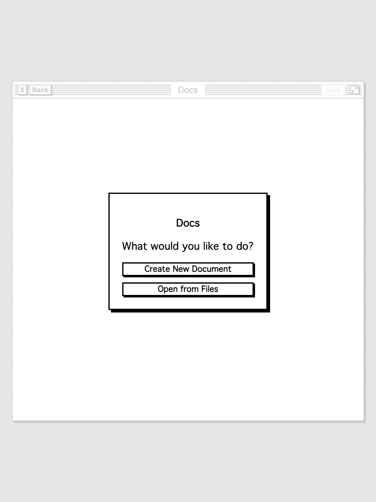
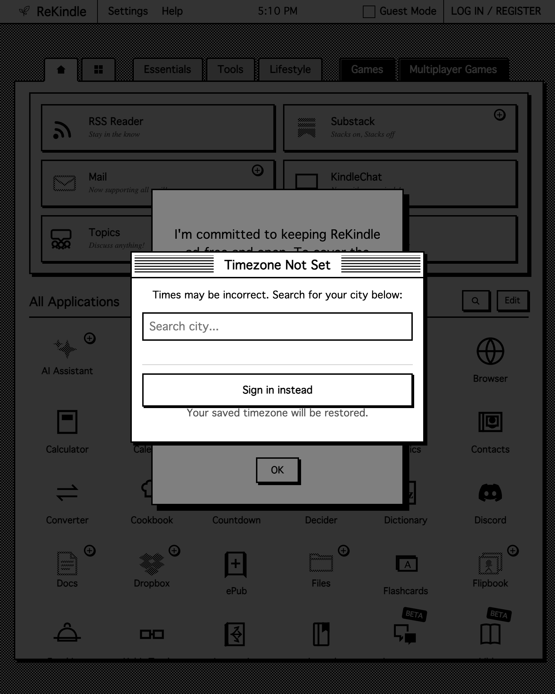
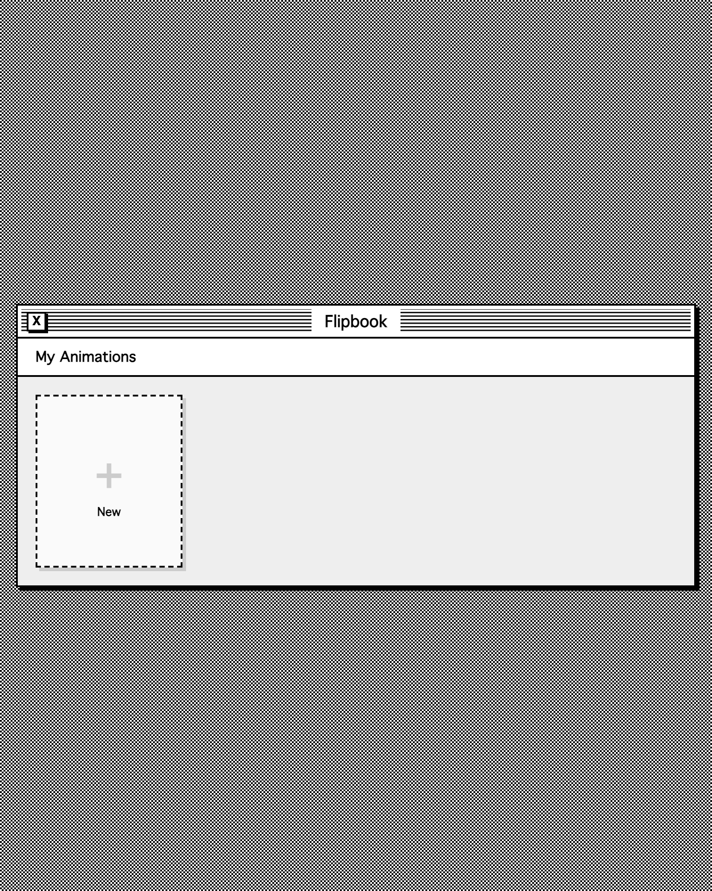
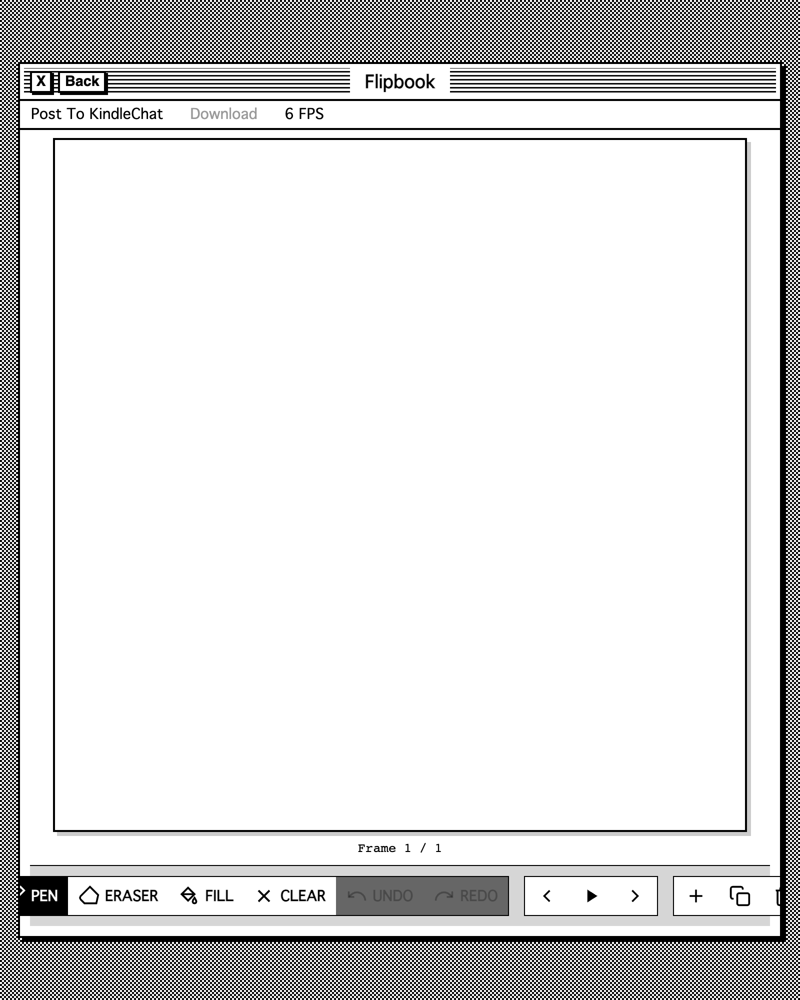

# ReKindle+ App Audit — 26 October 2026

An audit of the apps that require a ReKindle+ membership, based on a live signed-in session plus source review. **Implementation status: see [rekindle-plus-implementation-2026-10-26.md](rekindle-plus-implementation-2026-10-26.md).** It covers the **13 apps currently shown as `plus` on the dashboard**, the Pro-gated **Mindmap export**, and the hidden legacy **QuickNotes** page.

> **Method:** signed in with the supplied Pro test account; captured every app at **800×1000** (Kindle Paperwhite-class layout) and **600×800** (narrow check); reviewed the German locale (`?lang=de`) and dark mode (`?theme=dark`); exercised Docs (create → type → save → Files → delete), Photo Frame (upload → slideshow → delete), Flipbook (gallery → editor), Mindmap (new → export), AirType (display QR and phone connect), the Quick ToDo/QuickNotes onboarding, and Mail's reader. Source review covered the Pro gate, Firestore/Storage/RTDB rules, Cloud Functions, and the external workers.
>
> **Limitations:** external accounts (Dropbox, Bluesky, Mastodon, Pinterest, Substack) were not connected, so those apps were reviewed at their connection screens and in source; no physical Kindle/Chromium 75 device was available. Compatibility findings are static or layout-based, not hardware-tested.
>
> The account password was shared for this audit — rotate it when you are done.



---

## 1. Executive summary

The ReKindle+ suite is unusually broad for a $2/month tier: 13 apps, several of which are genuinely useful on an e-reader rather than demoware. **Mail, Files/Docs, Quick ToDo, AirType and Flipbook** are the strongest differentiators. The suite's weak points are not missing features so much as **trust, polish and consistency**: four apps can render untrusted HTML without sanitising it, two AI/OCR workers can be used without any account, the Pro gate is duplicated and occasionally contradictory, and several screens look like they came from different products.

### What is working

- **Mail** is a real mail client: multiple accounts, a unified inbox, threading, folders, search, read/archive/delete, Gmail/Yahoo/iCloud app-password setup, and a genuinely good Microsoft device-code flow that works when the Kindle cannot load Microsoft's JavaScript sign-in page.
- **Files + Docs** form a coherent pair. A document saved in Docs appears in Files; the 100 MB quota is shared with Photo Frame, and Storage rules enforce Pro.
- **Photo Frame** does the hard parts: client-side compression, ordering, shuffle/sequential, fit/crop, tap-to-advance, fullscreen, and an inactivity-hidden Exit button. The slideshow works.
- **Flipbook** has a real editor (pen/eraser/fill/clear/undo/redo, frames, FPS, export, KindleChat sharing) with both local and cloud persistence.
- **AirType** is a genuinely novel Kindle feature: a QR code and a six-digit code pair a phone as a keyboard, and notes land in the existing Notes collection.
- **Quick ToDo / QuickNotes** use handwriting OCR rather than a tiny on-screen keyboard — the right interaction for e-ink — and Quick ToDo supports Google Tasks or local storage.
- **The backend where it matters is Pro-aware.** Mail Cloud Functions call `assertMailAccess`; Storage rules require `isPro()` for `files`/`photos`; `pro_data` and `privateSettings/ai` are owner + Pro only. The Outlook refresh token stays server-side in `mail_oauth/{uid}`.
- **Pinterest's cross-device handoff** is the model the other integrations should copy: connect on a phone/computer, then restore the connection on the Kindle.

### Top 10 recommendations

| # | Recommendation | Why it matters | Effort | Priority |
|---|---|---|---|---|
| 1 | Sanitise or sandbox every untrusted HTML sink (Mail bodies, Substack `body_html`, Mastodon status HTML, AI markdown) and block remote images by default | A malicious email can run script in the ReKindle origin, read `localStorage`, and decrypt stored mail credentials. This is a credible account-takeover chain, not a theoretical XSS | M | **P0** |
| 2 | Put authentication and quota on the AI/OCR workers | A valid `POST` with no account returns an AI answer today; the client-side 10/day quota is bypassable | M | **P0** |
| 3 | Fix the i18n warm-cache race in `js/i18n.js` | Non-English users see English screens on repeat visits. Reproduced in German: Docs cold = translated, Docs warm = English | S | **P0** |
| 4 | Rework the Pro paywall/funnel: app-specific headline, price, 3 benefits, guest vs member CTA, link to `help#pro`; stop the timezone prompt covering it | The current modal says "I'm introducing a supporter tier", shows no price, and can be blocked by a higher-z-index timezone prompt | S | **P0** |
| 5 | Stop storing the AI API key in Firestore while telling users it is "stored locally" | The copy is false, and a cloud copy widens the blast radius of any XSS | S | **P0** |
| 6 | Lazy-load Docs' 2.3 MB of editor libraries and give Docs a real home screen | CKEditor (1.3 MB) + Mammoth (621 KB) + docx (380 KB) load before the user chooses anything; the first screen is a modal over a blank page | M | **P1** |
| 7 | Fix Flipbook's gallery height, toolbar clipping and missing Kindle zoom exemption | The gallery is a 318 px window in a 1000 px viewport; the bottom toolbar is visibly cut off at 800 px; drawing is offset when the user scale is not 1 | S | **P1** |
| 8 | Decide what Files is: a document locker or a 100 MB drive — then make the UI match | It accepts only `.doc`/`.docx`, single-file, while showing image previews and a "Files" name. Users will expect a drive | M | **P1** |
| 9 | Give the AI Assistant a conversation: send history, persist threads, stream responses | It sends only the latest prompt, so it cannot follow a conversation — the core promise of a chat app | L | **P1** |
| 10 | Add Mail attachments, drafts, Sent-folder append and server-side search | These are table stakes for a client that markets "all mail"; inbound attachments are explicitly returned as `[]` | L | **P1** |

---

## 2. Scorecard

Ratings are relative to the app's own ambition, not a single universal bar.

| App | What it is | Maturity | Kindle fit | Biggest single issue | Priority |
|---|---|---|---|---|---|
| **Mail** | IMAP/SMTP client | High | Good | Untrusted email HTML in Shadow DOM; no attachments/drafts/server search | P0 |
| **Files** | 100 MB file store | High | Medium | Scope mismatch: `.doc`/`.docx` only, but presented as "Files" | P1 |
| **Docs** | CKEditor + DOCX import/export | Medium | Medium | 2.3 MB of libraries on load; modal home; no autosave/recent docs | P1 |
| **AI Assistant** | Multi-provider chat | Low–Medium | Medium | No conversation memory, no history, false key-storage copy, unauthenticated worker | P0 |
| **Quick ToDo** | Handwriting → tasks | Medium | High | Silent OCR failures; Google Tasks re-auth roughly hourly | P1 |
| **AirType** | Phone as keyboard | Medium | High | Onboarding hides the primary action; session rules trust any signed-in user | P1 |
| **Flipbook** | Pixel animation editor | Medium | Low | Gallery window 318 px; toolbar clipped; zoom offset | P1 |
| **Photo Frame** | Photo slideshow | High | Medium | Grid loads full-size originals; no offline cache | P1 |
| **Dropbox** | Dropbox browser | High | Medium | Read-only (no upload); no search; Kindle connect friction | P2 |
| **Bluesky** | Bluesky client | High | Medium | Zero i18n; ignores content labels | P1 (safety) |
| **Mastodon** | Mastodon client | High | Low | Manual token setup; raw HTML; ignores spoilers/sensitive media | P1 |
| **Pinterest** | Pinterest browser/saver | High | Medium | `loading="lazy"` is a no-op on Chromium 75; no public browse before connect | P2 |
| **Substack** | Substack reader | High | Medium | Raw `body_html`; tracking pixels; no public discovery | P2 |
| **Mindmap** | Mind maps (free; export is Pro) | Medium | High | Custom white-wash paywall; export gate is invisible until tapped | P2 |
| **QuickNotes** | Legacy handwriting notes | Low | High | Hidden and Pro-gated; lapsed users may lose access to old notes | P3 |

---

## 3. Cross-cutting findings

### 3.1 The i18n warm-cache race (P0, S)

`js/i18n.js` applies translations as soon as the locale `fetch()` resolves. If that fetch is served from cache **before `<body>` exists**, `applyTranslations()` runs against an empty document; the MutationObserver only sees nodes added later, so the static `data-i18n` markup is never translated. The result is intermittent and cache-dependent.

Reproduced with the German locale:

| Visit | Docs startup text | `window.t('docs.modal.startup.msg')` |
|---|---|---|
| Cold cache | "Was möchten Sie tun?" | "Was möchten Sie tun?" |
| Warm cache (after visiting another German page) | "What would you like to do?" | "Was möchten Sie tun?" |

Pages that load `i18n.js` early in a long `<head>` are most exposed: Docs, Mindmap, AirType and many non-Pro pages. Mail/Files usually win the race because their i18n script is at the end of `<head>` — but that is timing, not design.

**Fix (small, universal):** after the locale resolves, apply once immediately **and** once on `DOMContentLoaded`:

```js
function applyWhenReady(t) {
  applyTranslations(t);
  if (document.readyState === 'loading') {
    document.addEventListener('DOMContentLoaded', function () {
      applyTranslations(t);
    }, { once: true });
  }
}
```

Also re-scan existing nodes when the observer starts. Add a regression test that loads a page with a warm locale cache and asserts a known `data-i18n` element is translated.



### 3.2 The Pro gate is an upsell, not an authorization boundary (P0, M)

`pro-gate.js` is a client-side overlay. That is acceptable **only** where Firestore/Storage rules enforce Pro — and it is not true everywhere:

- **AI worker:** `POST https://rekindle-oracle.timjarnott.workers.dev` with `{"prompt":"…"}` and no account returns a model answer. The client sends no token; the 10/day limit lives in a client-writable Firestore document (`users/{uid}/chatLimits/{date}`), so it can also be bypassed directly.
- **OCR worker:** `POST https://rekindle-ocr.timjarnott.workers.dev` with a base64 image and no account returns OCR output. Quick ToDo and QuickNotes both call it.
- **AirType RTDB:** `rtdb-rules.json` grants `.read` and `.write` on **every** `freewrite_sessions/{sessionId}` to **any** authenticated user. The only secret is a six-digit code, and the client-side owner check is not enforced by rules.

**Fix:**
1. Require a Firebase ID token on `rekindle-oracle` and `rekindle-ocr`, verify it server-side, check the `pro` claim, and rate-limit per uid. The browser already has the token; `fetch` just needs an `Authorization: Bearer` header.
2. Move the AI quota server-side (or keep a server mirror) so a user cannot reset `chatLimits`.
3. Bind `freewrite_sessions` to `ownerId` + a `participants` map; add participants through a small callable that validates the code, and rate-limit joins. Use a longer code or a random token in the QR URL.

This matters commercially as well as technically: the current setup lets anyone use the paid AI/OCR costs without paying, and it is exactly the kind of thing a curious user will discover.

### 3.3 Credential storage is obfuscation, not encryption (P0, M)

Several integrations store reusable credentials in the browser and/or Firestore:

| Integration | Where the secret lives | Protection |
|---|---|---|
| Mail (IMAP/SMTP) | `localStorage` + `users/{uid}/pro_data/mail` (`passEnc`) | PBKDF2 with **the public uid** as the password, AES-GCM |
| Bluesky | `localStorage` session (access/refresh JWT) + `rekindle_bsky_pass` | Same uid-derived PBKDF2 |
| Mastodon | `users/{uid}/pro_data` encrypted token | Same uid-derived PBKDF2 |
| Substack | `users/{uid}/substack_sid` encrypted | Same uid-derived PBKDF2 |
| Pinterest / Dropbox | `localStorage` + `pro_data` | Plaintext tokens |
| Quick ToDo (Google) | `pro_data/quicktodo` | Plaintext access token |
| AI Assistant | `privateSettings/ai.apiKey` | Plaintext + false "stored locally" copy |

The uid is not a secret: it is in `localStorage` as `rekindle_uid`. Anyone who can run script on the origin — including via a malicious email body (see 3.2 / Mail) — can decrypt the mail passwords and read the other tokens. The Outlook path already shows the right pattern: the refresh token stays in server-only RTDB (`mail_oauth`), and the browser only sees short-lived access.

**Fix:**
- Prefer OAuth refresh tokens stored server-side (as Outlook does) or server-side IMAP credential storage with default-deny rules.
- If client-side storage is unavoidable, do not call it encryption; use a device-bound key in IndexedDB and warn on shared devices.
- Remove the plaintext AI key from Firestore, or change the copy and encrypt it with a server-held key.
- Add a CSP and sanitise all HTML sinks so the XSS-to-credential chain is closed.

### 3.4 The guest funnel: the timezone prompt covers the Pro upsell (P0, S)

A new guest who taps a Pro app gets two stacked modals: the ReKindle+ upsell (`#generic-modal`) and the timezone prompt (`#tz-warning-overlay`, `z-index: 99999`, no dismiss button). The timezone prompt sits on top, cuts off the upsell, and blocks its buttons. The upsell copy is also stale ("I'm introducing a supporter tier") and shows no price.



**Fix:**
- Do not run `checkTimezoneOffset()` while any modal/overlay is open; queue it until the modal closes.
- Or make the timezone prompt a non-blocking banner with a dismiss/`Later` action. (It currently has no close by design, which is hostile on first run.)
- Raise the paywall above the timezone prompt if both must coexist.
- Update the upsell: "Mail is part of ReKindle+", three benefits, "From $2/month · $30 lifetime", and a CTA that differs for guests ("Log in / Join") and signed-in non-Pro users ("Subscribe").

### 3.5 Duplicate Pro checks and paywalls (P1, S)

Five apps (`mail`, `dropbox`, `chat`, `airtype`, `flipbook`) still carry a legacy `checkSubscription()`; eight still ship a legacy `#paywall-overlay` (the five above plus `quicktodo`, `substack`, `quicknotes`); and six call `rekindleProGate.check()` explicitly while the script auto-runs on load. Mail can therefore do two entitlement reads per launch, and cached Pro users can get the gate callback twice (Pinterest already guards against this; other apps do not). Mindmap has yet another custom paywall — a 98%-white wash rather than the shared System 7 card.

**Fix:** one idempotent `rekindleProGate.check()` returning a single promise; remove page-level `checkSubscription()`/paywall markup; make Mindmap call `rekindleProGate.showPaywall()`. Use `user.getIdTokenResult().claims.pro` as the fast path and Firestore only as the fallback/refresh, which also cuts one read per app launch.

### 3.6 Design-system drift (P1, M)

The Pro apps have grown their own shells:

- **Window widths:** 600 (Bluesky, Photo Frame), 650 (Mastodon, Pinterest), 700 (Quick ToDo), 800 (Dropbox, Chat, Files, AirType, Flipbook, Mindmap), 900 (Mail, Docs, Substack). Switching apps makes the window jump.
- **Body layout:** Files is full-bleed (`padding:0`, fixed); everything else uses the 20 px desktop margin. Photo Frame uses `padding:0` but centres a 600 px window.
- **No Pro app uses `js/ui-kit.js` or `js/system-dialog.css`.** Empty states, dialogs and buttons are hand-rolled; some are white washes (`rgba(255,255,255,0.9)`), some dim scrims, some plain cards.
- **Title bars:** Mail puts Settings/fullscreen on the right; Docs puts Back/Save; Flipbook puts Back; Photo Frame puts Upload/Start. There is no shared "app shell" vocabulary.

**Fix:** define two sanctioned widths — `window` (600) and `window.wide` (800) — and make Mail/Docs/Substack use `wide` deliberately. Adopt `rekindleEmptyState()` and `rk-dialog` across the suite, and add a Pro-app shell checklist to the visual audit.

### 3.7 Touch targets are below the project's own 48 px rule (P1, M)

Measured at 800×1000 (visible controls, CSS px):

| App | Examples | Height |
|---|---|---|
| Mail | Settings, Compose, Refresh | 29–32 |
| Docs | Save, toolbar buttons | 22 |
| Files | Upload, view toggle | 28–31 |
| Mindmap | Library/New/Edit/Center/Export | 29 |
| Photo Frame | Upload JPEGs, Start | 23 |
| AirType | Reset, Display/Input Device | 24–45 |
| Quick ToDo | Use Google/Local, GOT IT | 35–42 |

The System 7 look is small by nature, but the Kindle is a touch device: a 22 px toolbar icon is a miss waiting to happen. Increase hit areas with padding/min-height (48 px) while keeping the visual border small, or add transparent padding around icon buttons.

### 3.8 Performance: the Kindle pays for desktop-sized assumptions (P1, M)

- **Docs loads ~2.3 MB of JavaScript before the user chooses a document:** CKEditor 5 `ckeditor.js` 1.3 MB, Mammoth 621 KB, docx 380 KB, plus Firebase. Nothing on the startup modal needs any of the three editor libraries. Lazy-load them after "Create New Document" / "Open from Files".
- **Photo Frame renders a preview for every photo using the full download URL.** With a 100 MB quota that can mean hundreds of full-size JPEGs in the DOM. Generate a small thumbnail at upload (or use a Storage resize extension) and load previews through `IntersectionObserver`; native `loading="lazy"` is not available on Chromium 75.
- **Pinterest uses `loading="lazy"`**, which Chromium 75 ignores — so every pin image loads. Use `IntersectionObserver` there too.
- **Mail** loads three Firebase SDKs plus Functions and still has the legacy subscription read; **Chat** loads `marked` unversioned and unsanitised.
- **Flipbook** stores every frame as a data URL inside one Firestore document. Firestore documents cap at 1 MiB; a long, detailed animation will eventually fail to save, and the local `localStorage` copy can hit its quota first. Move frames to Storage (one object per frame) or cap/compress and show a real save error.

### 3.9 Offline and lapsed access (P1/P2, M)

Kindles are often offline. Most Pro apps fail closed with a network error:

- **Mail:** no offline cache of the last inbox; no outbox queue.
- **Docs/Files:** no local draft; a failed upload loses the edit unless the user notices.
- **Mindmap:** cloud maps are not cached locally when signed in; `saveData()` writes only Firestore for logged-in users.
- **Photo Frame:** every slide is a remote Storage URL, so the frame goes blank without Wi-Fi.
- **Quick apps:** have local fallbacks, but the OCR step is server-only and silently fails.

Separately, **cancelling Pro locks the user out of their own data**: Storage rules deny `files`/`photos`, Mail denies IMAP, and Flipbook/Photo Frame/Docs disappear behind the gate. A **read-only / export mode** for lapsed members (download Files/Photos, view Docs, copy notes) would reduce churn and is a fairer default.

### 3.10 Integration UX is inconsistent (P2, M)

Six apps depend on an external account, and each one asks in a different way:

| App | Connect method | Kindle-friendly? |
|---|---|---|
| Mail | provider list + app password, Outlook device code | Yes (best in class) |
| Dropbox | OAuth redirect in the browser | Unclear; no handoff |
| Pinterest | OAuth + "connect on another device, then reload" | Yes (good) |
| Substack | copy a SID cookie from a desktop browser | Clunky but workable |
| Bluesky | handle + app password | Yes |
| Mastodon | instance URL + manually created access token | High friction |

**Fix:** a shared "Connections" pattern with device-code/QR handoff where the provider allows it, a "how to get a token" helper for Mastodon, and a consistent status chip ("Connected as @…", "Token expires…", "Reconnect"). Dropbox and Substack should copy Pinterest's cross-device restore.

---

## 4. App-by-app

### 4.1 Mail

**Works:** the strongest app in the suite. Multi-account + unified inbox, threading, folder dropdown (Inbox/Sent/Drafts/Starred/All/Spam/Trash/Important), search field, read/archive/delete, reply, per-account labels, Outlook device-code OAuth, Gmail/Yahoo/iCloud app-password guidance, settings sync via `pro_data/mail`, and a reader pane that isolates email CSS in a Shadow DOM.

**Fix:**
- **Security:** Shadow DOM isolates styles, not scripts. `shadow.innerHTML = style + fullEmail.html` executes inline event handlers (verified with a local `` test), and there is no CSP. Render email in a **sandboxed iframe** (`sandbox` without `allow-scripts`) or sanitise with `js/safe-html.js` before injecting. Block remote images by default with a "Load images" button (tracking-pixel privacy).
- **Error path:** the body-fetch error is written as `< div style = …` (with spaces), so the user sees literal markup, and `${result.data.error}` / `${e.message}` are injected unescaped. Fix both.
- **Attachments:** `fetchEmailBody` returns `attachments: []` and compose has no attach control. Return attachment metadata + a download callable; allow attaching from Files (size-capped).
- **Drafts/Sent:** compose is plain text only, does not save drafts, and `sendEmail` does not append to Sent. Add autosaved drafts, CC/BCC, quoted reply, signature, and IMAP APPEND to Sent.
- **Search:** `filterEmails()` only hides rows already loaded (20 per page). Add an IMAP search callable for subject/from/body.
- **Reliability:** one cold capture showed `Load error`/`Could not open mailbox`, then a later capture loaded 7 emails. Add retry/backoff and a visible "Retry" action rather than a one-shot error.
- **Density:** rows are ~100 px; add a compact mode (more messages per screen) and keyboard focus.

**Bigger bet:** "Send to Kindle" from Mail attachments; rules/filters; a dashboard unread badge.

### 4.2 Files

**Works:** upload/download/delete, 100 MB quota, list/grid toggle, image preview, shared quota with Photo Frame, download menu, delete confirmation, and the Docs picker integration. The visual language is clean.

**Fix:**
- **Decide the product.** Help says "a small document locker, not a general-purpose drive", but the app is named **Files**, shows a 100 MB bar, and contains image-preview code. It currently accepts **only `.doc`/`.docx`, one file at a time**, so the image preview is dead code and the grid toggle only reflows documents. Either:
  - **Broaden it** to images, PDF, text, EPUB, ZIP, audio (Storage rules already allow `files/**`), with previews and multi-file upload; or
  - **Rename it** to "Documents"/"Docs Library" and remove the image/grid affordances.
- Add upload progress, duplicate-name handling, sort (name/date/size), and a search/filter for larger libraries.
- Replace the floating "No files. Upload something!" line with `rekindleEmptyState('No files yet', { action: 'Upload' })`.
- Escape `file.name` in the `title` attribute and text (currently raw), and normalise filenames before using them as Storage paths.
- Make the window consistent with the rest of the suite (currently full-bleed with no desktop margin).

**Bigger bet:** PDF/EPUB preview, folders, share links, and Dropbox as a sync source.

### 4.3 Docs

**Works:** CKEditor rich-text editing, DOCX import via Mammoth, DOCX export via docx + FileSaver, direct saving into `users/{uid}/files`, unsaved-changes confirm, Files picker, and a clean toolbar once a document is open. Tested end-to-end: created a document, typed, saved as `audit-test-doc.docx`, saw it in Files (`5.9 KB`), deleted it.

**Fix:**
- **Startup performance:** lazy-load CKEditor/Mammoth/docx only after "Create New Document"/"Open from Files". The initial modal needs none of them. This is the single biggest performance win in the suite.
- **Home screen:** the startup modal ("Docs — What would you like to do?") duplicates the title bar and offers no recent documents. Replace it with a real home: Recent (from Files), New, Open, and a short "Saved to Files" note.
- **Editor affordance:** after "Create New Document", focus remains on the body, and the editor is a huge blank white area with no placeholder. Focus the editor, add "Start writing…" placeholder/page margins, and show the filename + "Saved"/"Saving…" in the title bar.
- **Autosave:** add a local draft every few seconds and a clear dirty/saved indicator; currently a network failure on Save can lose the document.
- **File types:** Mammoth reads `.docx`, not legacy `.doc`. The UI accepts `.doc`, so either convert server-side or reject it with a clear message.
- **Touch targets:** toolbar buttons are ~22 px high; add padding/hit areas.
- **Toolbar:** add find/replace and a read-only/full-screen view; the heading dropdown is already present, but its 22 px hit area is too small.

**Bigger bet:** templates, PDF export, version history, and "Send to Kindle".

### 4.4 AI Assistant

**Works:** multi-provider settings (OpenAI, Gemini, Groq, xAI, Mistral, Perplexity, Together, Fireworks, Ollama, custom OpenAI/Gemini-compatible endpoints), model list fetching, a quick model bar, BYO key, a daily quota display, "Copy to Note", and a clean System 7 chat pane.

**Fix — this is the app most below its promise:**
- **It cannot hold a conversation.** `sendMessage()` sends `{ prompt: text }` only; prior messages are never included. Add a `messages` array (role/content) to the payload and worker, and keep a rolling window.
- **No history.** Reloading clears the thread. Persist conversations per user (title, messages, model, updatedAt), with a sidebar/list, rename, delete and search.
- **No streaming.** "Thinking…" then the full answer. Stream tokens or at least show progress for long replies.
- **XSS:** `marked.parse(text)` is assigned to `innerHTML`. Load `js/safe-html.js` and sanitise, or render markdown to inert nodes.
- **Key handling:** the UI says "Key is stored locally", but `saveSettings()` writes `apiKey` to `users/{uid}/privateSettings/ai` in Firestore. Remove the cloud write or change the copy and encrypt it; add a masked key display and a "Remove key" action.
- **Quota:** 10 messages/day is thin for a paid app; show the reset time and either raise it or make BYO key the headline. The quota is client-writable and the worker is unauthenticated (see 3.2).
- **First run:** blank chat with a placeholder. Add 3–4 example prompts (summarise an article, draft a reply, explain a word, plan a trip) and a one-line "what this is" explanation.
- **Provider label:** the header says "Gemini" while the default preset is OpenAI; make the label follow the active preset. Replace "Empty response from Oracle" with user-facing copy.

**Bigger bet:** system prompts/personas, attach a page/article for summarisation, citations, and a "continue in Docs/Notes" action.

### 4.5 Quick ToDo

**Works:** handwriting canvas with ruled paper, auto OCR after a pause, strike-through to complete, 16 rows, Google Tasks or local storage, speed presets (Normal/…), manual mode, info modal, and task sync.

**Fix:**
- **OCR failure is silent.** `processWriting()` catches errors and restores `originalText` (usually empty), so the user's writing disappears with no message. Keep the strokes until OCR succeeds, show "Couldn't read that — try again", and add a retry button.
- **No correction path.** OCR will misread names; let the user tap a recognized row to edit its text (and update the task/note), rather than only strike it out.
- **Google Tasks will ask for sign-in roughly hourly.** It uses the OAuth implicit flow (`response_type=token`), so there is no refresh token; `handleUnauthorized()` deletes the token and redirects. Move to authorization code + PKCE through a worker with a refresh token, stored server-side (as Mail/Outlook does). Never store the access token plaintext in `pro_data`.
- **Sync visibility:** after choosing Google/Local, there is no status chip ("Google Tasks · synced 2 min ago" / "Local only") and no error state. Add one to the title bar.
- **Onboarding:** two stacked modals (How to Use over the Google/Local choice) with a 90%-white wash; combine them into one flow and persist "don't show again". Use the shared dim scrim and 48 px buttons.
- **Capacity:** 16 rows with no archive/history; add a "view all" list or paging.

**Bigger bet:** due dates/reminders, recurring tasks, multiple lists, and "send to Google Tasks" from other apps.

### 4.6 AirType

**Works:** QR + six-digit pairing, phone/tablet roles remembered in `localStorage`, a clean full-screen QR screen, phone-side "Enter Code"/"Scan QR Code", notes saved to the existing `notes` collection, and a display view that is genuinely useful for long-form writing on a Kindle.

**Fix:**
- **Onboarding hides the point.** "Will you use this device as a display or as an input device?" is abstract; add one line per choice ("This Kindle will show what you type" / "This phone will type into the Kindle") and a simple two-device diagram. After choosing Display, the note list says "No notes found" with only a small "+ New Note" bar; add a prominent "Pair a phone" / "Start a new note" empty state, and a "Waiting for phone…" status on the QR screen.
- **Session security:** `freewrite_sessions/{id}` is readable/writable by any authenticated user (3.2). Bind it to the owner and an explicit participant, rate-limit joins, and use a longer/random code. The six-digit code is the only barrier to reading someone's typing.
- **Supply chain:** `html5-qrcode` is loaded from `unpkg.com` **unversioned and without SRI**. Pin a version and add an integrity hash; the QR library (`qrcodejs`) already does.
- **Role reset:** "Reset" is in the title bar; make it a settings action with a confirmation, and remember the role per device (it already does) so repeat users skip the modal.
- **Accessibility:** 24 px "Reset" and 45 px setup buttons; raise to 48 px.

**Bigger bet:** formatting controls on the phone (bold/italic/headings), offline queue for typed text, and "send to Docs" in addition to Notes.

### 4.7 Flipbook

**Works:** a real frame editor with pen/eraser/fill/clear, undo/redo, frame add/duplicate/delete, play/stop, FPS, onion skin (loaded index), GIF download, KindleChat posting, local + Firestore persistence, and a manifest gallery with thumbnails.

**Fix:**
- **Gallery height:** `.window` has the invalid property `max-min-height: 90vh`, so the gallery shrink-wraps to **318 px** in a 1000 px viewport and floats in the middle of the desktop. Use `min-height: 90vh` (or `height: 90vh`) and let the gallery grid fill it.
- **Toolbar clipping:** `.controls-container` is `flex-wrap: nowrap` with 12 buttons plus labels; at 800 px the "PEN" label is cut off on the left and the last button is cut off on the right. Allow wrap into two rows (or icon-only with `title`/aria labels) and set a 48 px minimum.
- **Kindle zoom offset:** Flipbook is the only canvas app without the documented `.window { zoom: 1 !important; }` exemption. `getPointerPos()` uses `getBoundingClientRect()` + `clientX`, so when `rekindle_scale` is not 1, strokes land away from the finger. Add the same override used by QuickNotes/QuickToDo/Mindmap.
- **Save reliability:** all frames are a data-URL array in one Firestore doc; 1 MiB limit. Move frames to Storage or cap/compress, and show a real "Save failed" message (currently `console.warn`/`.catch(console.error)` only).
- **Empty state/tutorial:** the gallery's only content is a dashed "New" tile. Add a one-line description ("Draw frame-by-frame animations") and a 3-frame sample or "How it works" link.
- **Gallery performance:** thumbnails are base64 in the manifest; keep them small and avoid decoding every animation at once.





**Bigger bet:** layers, a colour palette, onion-skin toggle, and export options (GIF speed/scale).

### 4.8 Photo Frame

**Works:** JPEG/PNG/WebP upload, client-side compression, ordering, shuffle/sequential, fit/crop, 10 s–30 min or manual advance, fullscreen, inactivity-hidden Exit, shared 100 MB quota, and a working slideshow (tested end-to-end).

**Fix:**
- **Preview grid loads full-size originals.** `renderPreviews()` sets `img.src = p.url` for every photo; with 100 MB of photos this can be hundreds of full images. Generate a thumbnail at upload and load it via `IntersectionObserver` (native lazy loading is unsupported on Chromium 75).
- **Offline:** cache photos (Cache API/IndexedDB) for the slideshow; a photo frame is a natural offline device, but every slide is a remote URL today.
- **E-ink flash:** the 400 ms white + 400 ms black flash between slides is a deliberate e-ink clear, but it strobes on LCD/phone. Make it an "E-ink refresh" option, default off outside Kindle.
- **Delete:** the X deletes immediately with no confirmation; add one (and clean up `_ORDER.json` when the last photo is removed — it currently leaves ~25 B counted).
- **Copy/labels:** the button says "Upload JPEGs" but accepts PNG/WebP; the quota is shared with Files but the UI doesn't say so. Say "Upload photos" and "100 MB shared with Files".
- **Quality:** compression is JPEG quality **0.3** at 2048 px. That is fine for a 6-inch e-ink screen but visibly soft on a tablet/phone; make it a setting (0.3 e-ink / 0.7 standard).

**Bigger bet:** captions, clock/weather overlay, scheduled on/off, and "use this as my wallpaper".

### 4.9 Dropbox

**Works:** OAuth PKCE, token refresh, folder browsing with breadcrumb and favourites, 500+ entry pagination, image/PDF/Office previews via thumbnails, text preview with escaping, download, and a clean connection screen.

**Fix:**
- **It is read-only.** No upload, no "save to Files", no "set as Photo Frame source". Add upload from Files (and/or a "Save to Files" action on any Dropbox file).
- **No search.** Dropbox's `filesSearchV2` is available; add a search field for large accounts.
- **Kindle connect:** the OAuth page is a desktop JavaScript flow; add the Pinterest-style "connect on a phone, then reload" path, or a device-code flow if Dropbox supports one.
- **Labels:** "Cloud Sync: `<email>`" at the bottom is the ReKindle account, not a Dropbox connection; it reads as if Dropbox is connected. Rename to "ReKindle account" or remove it.
- **Errors:** "Preview not supported for this file type type" (typo), and generic "Failed to load folder"; add a retry and a clearer message.
- **Tokens:** access/refresh tokens are plaintext in Firestore; see 3.3.

**Bigger bet:** offline pins, shared links, and a two-way "Files ↔ Dropbox" sync.

### 4.10 Bluesky

**Works:** a full client — home feed, discover/search, profiles, follows/followers, likes, notifications, messages, compose/reply/repost/like, image posts (thumbnails, 2 per post), session restore, and a polished login card.

**Fix:**
- **Zero i18n.** No `data-i18n` and no locale keys; the entire app is English. This is the largest localization gap in the suite.
- **Safety labels are ignored.** Bluesky returns content labels (adult, spam, etc.); the client renders everything. Respect `labels`/`contentLabelPrefs`, hide `!warn` media behind a tap, and offer "Show anyway".
- **Attribute escaping:** `img.alt` is injected unescaped into `alt="…"`; `author.handle` is interpolated into inline `onclick` strings. Escape both (and prefer `addEventListener`/`data-*` over inline JS).
- **Session storage:** `bsky_session` (access + refresh JWT) is plaintext in `localStorage`; with no CSP, an XSS is a full account takeover. Consider storing only the refresh token, using IndexedDB, and adding CSP.
- **Feed performance:** images are requested eagerly and avatar images are not size-capped; use CDN thumbnails and `IntersectionObserver` for feed media.
- **Link handling:** external links navigate away from the app; open them in the Browser app (as Mail does).

**Bigger bet:** custom feeds/lists, muted words, and drafts.

### 4.11 Mastodon

**Works:** home/trending/messages/notifications/profile tabs, favourites/boosts, media grids, thread/profile views, and token storage encrypted with a uid-derived key (see 3.3).

**Fix:**
- **Connection friction:** the user must create an access token in their instance settings and paste it. Mastodon supports dynamic app registration + OAuth; implement it, or at minimum add a step-by-step helper with a direct link to `/settings/applications` on the entered instance.
- **Raw HTML:** `${displayToot.content}`, `${displayToot.account.display_name}`, and `${avatar_static}` are injected into `innerHTML` unescaped. Sanitise with `js/safe-html.js` and escape names/URLs. A malicious instance can return active HTML.
- **Content warnings:** `spoiler_text` and `sensitive` are ignored; media and text are shown unconditionally. Add a "Show more" wrapper and blur sensitive media, matching Mastodon's own behavior.
- **i18n:** only 9 keys; most UI is English. Add coverage.
- **Link handling:** external links leave the app; route them through Browser.
- **Token storage:** PBKDF2(uid) is obfuscation (3.3).

**Bigger bet:** instance discovery, lists, filters, and scheduled posts.

### 4.12 Pinterest

**Works:** OAuth through a worker, cross-device token restore with a clear Kindle explanation, saved pins/boards, search, pin detail, save-to-board, profile, pagination, and error/empty states. The connection screen is one of the best in the suite.

**Fix:**
- **`loading="lazy"` is a no-op on Chromium 75**, so every pin image loads. Use `IntersectionObserver`.
- **No public browse before connecting.** Pinterest is a discovery app; let guests browse trending/search results (public API or a curated feed) and only require connection for boards/saves. That would make the first-run screen less of a wall.
- **Image sizing:** confirm the API returns a 236/600 px variant rather than originals; pick the smallest adequate size for the 800 px screen.
- **Dynamic strings:** several error/empty strings are hardcoded English despite 24 locale keys.
- **Token storage:** plaintext in `localStorage` + `pro_data` (3.3).

**Bigger bet:** create/upload pins, offline board cache, and "set pin as wallpaper/Photo Frame".

### 4.13 Substack

**Works:** subscriptions + aggregated inbox, publication pages, reader, paid-post support via the SID cookie, search, pagination, 429/load-error handling, and a clear connect modal with browser instructions.

**Fix:**
- **Raw `body_html`:** `content.innerHTML = '<h1>' + post.title + '</h1>' + post.body_html` — titles and bodies are unsanitised, and remote images/tracking pixels load automatically. Sanitise with `js/safe-html.js`, block remote images by default, and escape titles.
- **No public discovery:** like Pinterest, Substack could show a few public publications/posts before connecting; the current screen is a hard wall.
- **Cross-app:** add "Save to Read Later" / "Open in Reader" and offline caching for the reader.
- **i18n:** 11 keys; most reader/error/empty strings are English.
- **SID security:** a Substack SID is a powerful session cookie; it is encrypted with the public uid (3.3). Prefer OAuth if Substack offers it.

**Bigger bet:** podcast/audio support, notes, and a "send to Kindle" action.

### 4.14 Mindmap (free app; Pro export)

**Works:** a genuinely free canvas tool with library, cloud sync, drag/pan/zoom, links, PNG/SVG export, and a clean full-window editor. It is a good freemium hook.

**Fix:**
- **Paywall consistency:** `showMindmapPaywall()` creates its own 98%-white overlay instead of using `rekindleProGate.showPaywall()`. It is the only Pro paywall that still looks like the pre-audit version and it is hardcoded English.
- **Export discoverability:** free users see an "Export" button with no indication it is Pro until they tap it. Add a small "PRO" badge and a one-line "Export is included in ReKindle+" hint.
- **Touch:** the only way to add a node is **double-click** on empty canvas; the status bar literally says "Double-click to add a node." On a touch Kindle, double-tap is unreliable. Add a visible "+ Node" button (and keep double-tap as a shortcut). Change copy to "Double-tap".
- **First run:** a single "Double tap to edit" node with no explanation of how to branch. Add a 3-step hint or a starter template.
- **Offline:** when signed in, maps live only in Firestore; cache them locally and queue writes.
- **Privacy:** the status bar shows the full account email address; show the username/handle instead.
- **Undo:** no undo for node/link edits.

### 4.15 QuickNotes (hidden legacy)

The Help data describes `/quicknotes` as "an older handwritten-notes page superseded by Quick ToDo and Notes. Pro-gated; kept for compatibility." That creates a trap: a lapsed member cannot open the page to retrieve notes written there, and the page is not discoverable from the dashboard. Either:

- make it **read-only for existing notes regardless of Pro** (or add an export), and link it from Help; or
- redirect it to Quick ToDo/Notes after a one-time migration.

Do not invest more in the handwriting/OCR stack here — Quick ToDo and Notes are the forward path.

---

## 5. Prioritised roadmap

### Now — trust, conversion and obvious breakage (1–2 weeks)

| Task | App/Area | Effort | Why now |
|---|---|---|---|
| Sanitise/sandbox Mail, Substack, Mastodon, AI output; block remote images; add CSP | Security | M | Closes the XSS → credential-theft chain |
| Authenticate AI/OCR workers; move quota server-side; bind AirType sessions | Security | M | Stops free use of paid APIs and session snooping |
| Fix i18n warm-cache race | Global | S | Non-English users currently see English on repeat visits |
| Suppress/queue timezone prompt while modals are open; fix upsell z-index | Dashboard | S | Unblocks the Pro purchase path |
| Rewrite paywall copy: app name, 3 benefits, price, guest/member CTA, `help#pro` link; add trial/refund line | Paywall | S | Conversion |
| Stop writing the AI key to Firestore (or change the copy + encrypt) | AI | S | Trust |
| Flipbook: `min-height:90vh`, toolbar wrap, zoom exemption | Flipbook | S | Visible breakage on the target device |
| Add Pro descriptions for Dropbox, AI Assistant, Files, Docs; replace "+" with "PLUS"/lock | Dashboard | S | Discoverability |
| Use `rekindleProGate.showPaywall()` in Mindmap; remove the 8 legacy paywalls and 5 legacy `checkSubscription()` blocks | Pro gate | S | Consistency + fewer reads |
| Touch-target pass on the top 6 apps (48 px hit areas) | Design | M | Kindle usability |

### Next — core product depth (1–2 months)

| Task | App | Effort |
|---|---|---|
| Lazy-load CKEditor/Mammoth/docx; Docs home with recents, autosave, filename/saved status, placeholder | Docs | M |
| Files: broaden types + multi-upload/progress, or rename to Documents; empty state; escaping | Files | M |
| Mail: attachments (read + send), drafts, Sent append, CC/BCC, quoted reply, IMAP search, retry | Mail | L |
| AI: conversation history, threads sidebar, streaming, safe markdown, example prompts, provider label | AI | L |
| Quick ToDo/Notes: retain strokes on OCR failure, retry, tap-to-edit text, sync status | Quick apps | M |
| Google Tasks: code + PKCE + refresh token, server-side storage | Quick ToDo | M |
| Photo Frame: thumbnails + IntersectionObserver, offline cache, optional flash, delete confirm, shared-quota label | Photo Frame | M |
| AirType: onboarding copy/diagram, empty-state CTA, waiting status, pinned QR lib | AirType | S/M |
| Adopt `ui-kit` empty states + `system-dialog` cards across Pro apps; two window widths | Design | M |
| Read-only/export mode for lapsed Pro (Files, Photos, Docs, notes) | Business | M |

### Later — growth and parity (quarter)

| Task | App | Effort |
|---|---|---|
| Bluesky: full i18n, content labels, attribute escaping, session hardening | Bluesky | M |
| Mastodon: OAuth + sanitisation + spoilers/sensitive media + i18n | Mastodon | M |
| Dropbox: upload/search, Kindle handoff, token storage | Dropbox | M |
| Pinterest: IntersectionObserver, public browse, image sizing | Pinterest | S/M |
| Substack: sanitise body, public discovery, Read Later/Reader, offline | Substack | M |
| Cross-app actions (Mail↔Files, Dropbox→Photo Frame, AI→Docs, Pinterest→Wallpaper) | Suite | L |
| Offline-first cache for Mail/Docs/Mindmap/Photo Frame | Suite | L |
| Instrument activation/paywall funnel per app | Analytics | S |

---

## 6. Quick wins under a day

1. **i18n:** add the `DOMContentLoaded` re-apply in `js/i18n.js`.
2. **Timezone/paywall:** skip `checkTimezoneOffset()` while `#generic-modal` is open (or raise the modal above 99999).
3. **Flipbook:** replace `max-min-height: 90vh` with `min-height: 90vh`; add `flex-wrap: wrap` to `.controls-container`; add the zoom override.
4. **Paywall copy:** "**Mail** is part of ReKindle+", "$2/month · $15/year · $30 lifetime", 3 bullets, "Log in to subscribe" for guests, "Subscribe" for members.
5. **AI copy:** change "Key is stored locally" to match reality, or delete the Firestore `apiKey` write.
6. **Docs:** focus the editor after Create and add a "Start writing…" placeholder.
7. **Files:** replace the floating empty line with `rekindleEmptyState`.
8. **Dashboard:** add one-line descriptions for Dropbox, AI Assistant, Files, Docs.
9. **Mail:** block remote images until the user taps "Load images"; fix the `< div` error markup.
10. **Mindmap:** use the shared paywall and add a PRO badge to Export.

---

## 7. Appendix

### Method and evidence

- Captures: 800×1000 and 600×800, Chromium 1248 headless (functional/layout) plus WebKit for the base homepage check; `?lang=de` and `?theme=dark` variants.
- Interaction tests: Docs create/type/save/delete; Photo Frame upload/slideshow/delete; Flipbook gallery/editor; Mindmap new/export; AirType display QR/phone connect; Quick ToDo/QuickNotes onboarding; Mail reader; Files list.
- Source review: `pro-gate.js`, `js/i18n.js`, `mail.html`, `files.html`, `docs.html`, `chat.html`, `quicktodo.html`, `quicknotes.html`, `airtype.html`, `flipbook.html`, `photoframe.html`, `mindmap.html`, `dropbox.html`, `bluesky.html`, `mastodon.html`, `pinterest.html`, `substack.html`, `firestore.rules`, `storage.rules`, `rtdb-rules.json`, `firebase-functions/index.js`.
- Worker check: empty and valid `POST`s to `rekindle-oracle`/`rekindle-ocr` without credentials. One small prompt was sent to confirm the AI worker path; no bulk use.
- XSS check: Shadow DOM `innerHTML` with an `onerror` handler executed in a local Chromium page (confirming the Mail body risk, without sending a malicious email).

### Key metrics

| Metric | Value |
|---|---|
| Visible Pro apps | 13 |
| Pro-gated pages (incl. legacy QuickNotes) | 14 |
| Legacy `checkSubscription()` blocks | 5 |
| Legacy `#paywall-overlay` blocks | 8 |
| Apps using `js/ui-kit.js` / `js/system-dialog.css` | 0 / 13 |
| Distinct `.window` max-widths | 5 (600, 650, 700, 800, 900) |
| Docs libraries loaded before first action | ~2.3 MB (CKEditor 1.3 MB + Mammoth 621 KB + docx 380 KB) |
| AI messages/day (built-in key) | 10 |
| Files accepted types | `.doc`, `.docx` only |
| Photo Frame quota | 100 MB, shared with Files |
| Flipbook gallery height at 800×1000 | 318 px |
| Mail inbound attachments | always `[]` |
| Pro price points | $2/mo, $15/yr, $30 lifetime |

### Screenshots

- [Overview contact sheet](img/overview.png)
- [Docs — empty editor](img/docs-empty.png)
- [Docs in German on a warm cache](img/docs-de-warm-cache.png)
- [Flipbook gallery](img/flipbook-gallery.png)
- [Flipbook editor toolbar clipping](img/flipbook-toolbar.png)
- [Guest Pro upsell covered by timezone prompt](img/guest-paywall-timezone.png)
- [Photo Frame slideshow](img/photoframe-slideshow.png)

---

*Report prepared 26 October 2026. The test account's password was shared for this audit and should be rotated; no credentials are reproduced in this document.*
